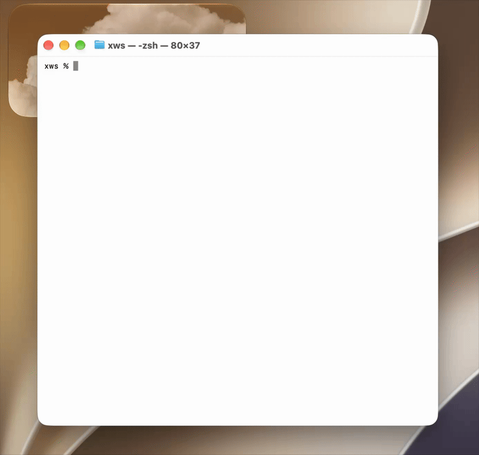

<h1>
  
  <span>xws</span>
</h1>

**Zero-Pollution Multi-Project Context Isolation for Demanding Engineers, Pre-Sales & Technical Consultants.**

`xws` gives demanding engineers, solutions architects, sales engineers, and enterprise consultants isolated, reproducible project environments natively inside their terminal. Switch between customer POCs, live product demos, and client codebases in seconds without subshell latency, conflicting global runtimes, or cross-client environment leakage.

---

### Why xws?

Jumping between client engagements and prospect demos is hazardous: a stale `AWS_PROFILE`, an incompatible node version, or a conflicting Python virtualenv can derail an enterprise presentation or accidentally expose one client's tokens to another.

Traditional tools either force you into sluggish nested subshells (`nix-shell`, subshell wrappers), pollute global configuration (`~/.zshrc`), or require heavyweight containerization that slows down terminal workflows. 

**xws** replaces this with a **native, stacked context model** engineered for high-stakes delivery:

* **The Demo Safety Net** — Guarantee clean state for live demos. Activating a workspace exports only that engagement's declared environment variables, prepends isolated `bin/` tools to your `PATH`, and sources project hooks. Popping the workspace cleanly unexports variables and restores your prior shell state layer by layer.
* **Instant Ephemeral Workspaces** — Spin up isolated terminal contexts with independent runtimes (`pyenv`, `node`, `rust`, `jdk`) in seconds. Switch from a FinTech client's Java 17 service to an AI startup's Python 3.12 stack with a single keystroke.
* **Enterprise Grade, Local-First, Zero Telemetry** — MIT licensed, completely offline, and telemetry-free. No cloud daemons, no background tracking, and no external calls—making it fully compliant for regulated environments, air-gapped workstations, and Tier-1 financial institutions.

---

### Key Capabilities

* **Native Shell Execution** — Directory navigation (`cd`), environment variables, `PATH` updates, and activation hooks run directly inside your active Bash or Zsh session without launching nested subshell processes.
* **Stacked Context Switching** — Jump into a client triage session mid-workflow (`xws push client-acme`). When finished, pop it (`xws pop`) to automatically return to your previous directory and restore your prior environment.
* **Zero-Leakage Variable Restoration** — Declare project variables in declarative `bin/env` files. `xws` records the exact prior state of every variable (set, exported, or unset) and restores it atomically upon deactivation.
* **Frictionless Terminal Picker** — Run `xws` with no arguments to launch an interactive, keyboard-driven UI to search and switch between client environments. Supports both alternate screen buffer and inline display modes.
* **Pre-Baked Profiles & Stacks** — Bootstrap customer environments instantly with built-in profiles (**Python** workspace venvs, **Conda**, **Rust**, **Java** JDK path auto-discovery) and extensible features (**venv** isolation on Conda, **Golang**, custom internal toolchains).
* **Defensive, Symlink-Hardened Storage** — Workspaces live cleanly under `$HOME/xws/workspaces` with atomic session state stored in `$HOME/.xws` using restricted permissions (`0o700`/`0o600`) and symlink-traversal guards.

---

### Demo



---

### Supported Platforms

* **macOS** (Intel and Apple silicon)
* **Linux** (x86-64)
* **Shells:** Bash (4+) and Zsh
* **`bash` on `PATH`:** `xws create` runs each new workspace's `bin/once` setup script with `bash`, even when you use Zsh.

---

### Quick Start

#### 1. Install xws

Install the pre-compiled binary distribution with the automated installer:

```bash
curl -fsSL https://raw.githubusercontent.com/pre-cursor/xws/master/xws-install | sh -s -- install --latest
```

*(Installs to `$HOME/xws` by default. Set `XWS_INSTALL_PREFIX` to customize the installation location).*

#### 2. Initialize Shell Integration

Add `xws` to your interactive shell startup configuration:

```bash
# For Bash
curl -fsSL https://raw.githubusercontent.com/pre-cursor/xws/master/xws-install | sh -s -- init bash

# For Zsh
curl -fsSL https://raw.githubusercontent.com/pre-cursor/xws/master/xws-install | sh -s -- init zsh
```

Reload your shell (`source ~/.bashrc` or `source ~/.zshrc`) to activate.

#### 3. Spin Up Client Workspaces

Create clean, isolated workspaces for your customer engagements:

```bash
# Create client contexts (the Conda environment must already exist)
CONDA_ENV=acme-env xws create acme-poc --profile conda
xws create globex-demo --profile rust

# Activate the Acme engagement
xws push acme-poc
```

Activating a workspace switches your terminal to its source directory, updates `PATH`, exports declared environment variables, and executes local activation scripts.

#### 4. Stack Contexts During Live Work

Need to quickly check an issue in another project without losing your place? Push another context:

```bash
# Push into Globex demo environment while inside Acme
xws push globex-demo

# Pop Globex: safely tears down Globex variables and returns to Acme
xws pop

# Pop Acme: returns to your base shell exactly where you started
xws pop
```

---

### Command Reference

| Command | Description |
| :--- | :--- |
| `xws` | Launch the interactive keyboard workspace picker. |
| `xws create [--profile NAME] [--with-feature NAME] NAME` | Provision an isolated workspace with baseline stacks and features. |
| `xws push NAME` *(aliases: `activate`, `use`)* | Activate a workspace in the current shell and push it onto the context stack. |
| `xws pop` *(alias: `deactivate`)* | Safely deactivate the current workspace and restore the prior environment. |
| `xws ls` *(alias: `list`)* | List all workspaces (marks the currently active workspace with `*`). |
| `xws profiles` | List available runtime profiles (e.g. `python`, `conda`, `rust`, `java`). |
| `xws features` | List optional feature extensions (e.g. `venv`, `golang`). |
| `xws which NAME` | Print the filesystem path to a workspace's isolated `bin/` directory. |
| `xws path NAME` | Print the workspace root path. |
| `xws mv SOURCE TARGET` | Rename a workspace (guarded against active sessions). |
| `xws rm NAME...` | Delete one or more workspace environments. |
| `xws version` | Print the installed `xws` version. |

---

### Configuration

#### Environment Variables

| Variable | Description |
| :--- | :--- |
| `XWS_PREFIX` | Base directory for workspace storage (workspaces live under `$XWS_PREFIX/workspaces`). |
| `XWS_STATE_HOME` | Private session-state and configuration directory (defaults to `~/.xws`). |
| `XWS_PICKER_DISPLAY` | Picker UI rendering mode: `alternate` (fullscreen buffer) or `inline`. |
| `XWS_TEMPLATES_DIR` | Directory holding the packaged `profiles/` and `features/` (`share/xws/templates` when installed, `<repo>/templates` in a checkout). It only moves the packaged templates; user overrides in `$XWS_PREFIX/templates` are unaffected. Whatever it points at is copied into new workspaces and executed, so it is trusted like `XWS_PREFIX`: only set it to a location you control. |
| `XWS_PICKER` | Custom path override for the `xws-picker` binary executable. |

#### Persistent Display Preferences

To keep the picker inline rather than taking over the terminal screen, configure `~/.xws/config.toml`:

```toml
screen_buffer = "inline" # or "alternate"
```

You can also override it per invocation:

```bash
XWS_PICKER_DISPLAY=inline xws
```

---

### Architecture & Security

`xws` guarantees that your shell remains fast, predictable, and immune to command injection:

```
Interactive Bash or Zsh Shell
  └── Sourced xws shell function
        ├── xws-picker CLI (Rust engine: state validation, stack tracking, UI)
        ├── XWS Shell Protocol v1 (Machine-readable TSV Base64 stream over stdout)
        └── Parent Shell Adapter (Applies cd, export, unexport, and source)
```

#### Protocol Safety Contract
Communication between the Rust binary and your shell uses **XWS Shell Protocol v1**. The binary outputs line-oriented, tab-separated Base64 records to `stdout`. The shell adapter reads and safely passes these fields as quoted arguments to shell builtins (`export`, `cd`, `unset`). **Data is never evaluated through `eval`**, guaranteeing that variables containing special characters, whitespace, or quotes cannot execute arbitrary commands.

---

### Documentation

* [Getting Started Guide](https://github.com/pre-cursor/xws/blob/master/docs/GETTING_STARTED.md) — Walkthrough of profile setup, environment declarations, and hooks.
* [Installation Guide](https://github.com/pre-cursor/xws/blob/master/docs/INSTALLATION.md) — Manual compilation and custom prefix deployment.
* [Design Specification](https://github.com/pre-cursor/xws/blob/master/docs/DESIGN.md) — Full technical specification of stack semantics and protocol safety contracts.

---

### License

`xws` is open-source software licensed under the **[MIT License](https://github.com/pre-cursor/xws/blob/master/LICENSE)**.
